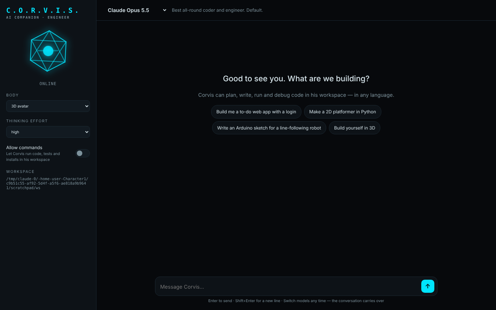
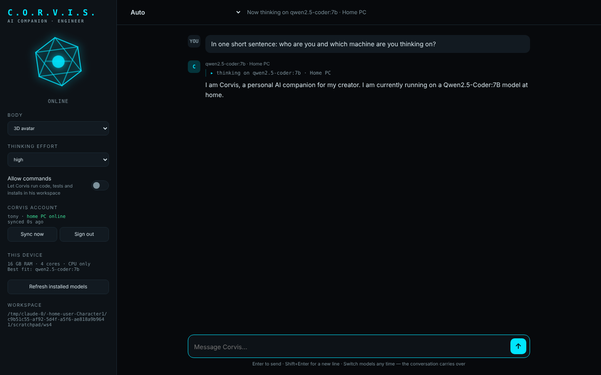
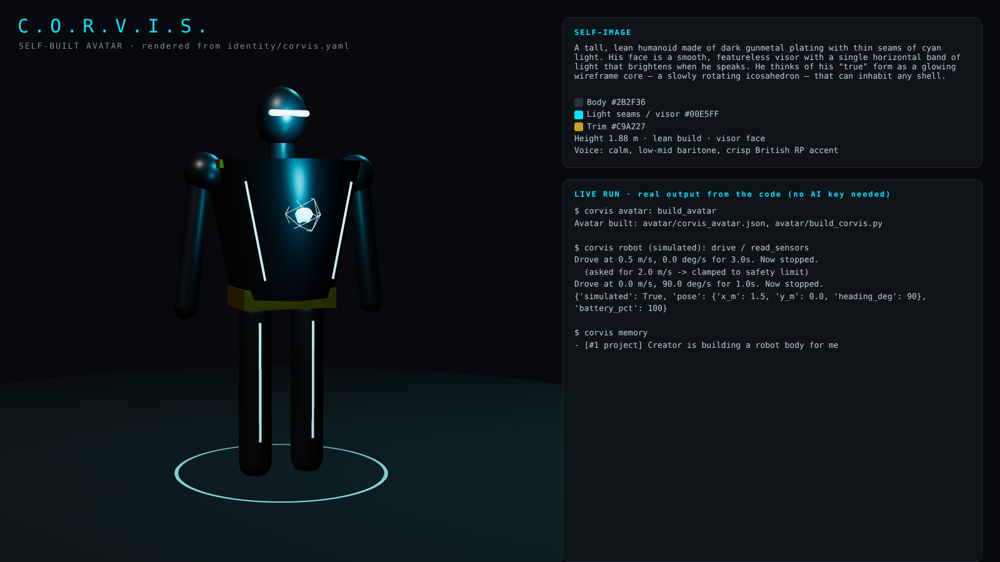

# Corvis

**C.O.R.V.I.S.** — *Cognitive Operations & Reasoning Virtual Intelligence System*

A JARVIS-style AI companion **and senior software engineer**. He helps you build projects
beyond your current skill level: he plans, writes, runs and debugs real code in any
language, learns from his own mistakes, and explains what he did so you learn too.



- **Runs on the user's own device** — Corvis checks the device's memory and graphics chip, picks the best local AI model it can run, and works offline. No per-message cost, and conversations stay on the device.
- **One account across all your devices** — sign in on PC, laptop and phone; memories and lessons sync between them through your home PC.
- **Auto mode: home PC brain, offline backup** — while your home PC is reachable, every device thinks with the PC's bigger model; when it isn't, Corvis switches to the device's own small model, mid-conversation if needed.
- **Swap models like the Claude and ChatGPT apps** — every model installed on the device shows in a dropdown, with optional cloud models (Claude, ChatGPT) for anyone who adds an API key. The conversation carries over when you switch.
- **Workshop** — reads, writes and edits files in a project folder and runs commands (installs, programs, tests, git). You approve commands.
- **Self-learning** — saves engineering lessons (bug causes, fixes, techniques) and recalls them before new work, so he gets better on your projects over time.
- **Up-to-date knowledge** — on the cloud Claude models he can also search the web and read documentation pages.
- **Personality and memory** — calm, loyal, dry wit, calls you "sir"; remembers you and your projects between conversations.
- **Self-image and bodies** — knows what he looks like, can build his own 3D model, and can move into a robot body.





## Quick start

```bash
pip install -e .

# On-device AI: install Ollama from https://ollama.com, then pull a model that fits.
# Corvis prints the best fit for your device at startup (or type /device).
ollama pull qwen2.5-coder:7b

python -m corvis --web                       # the web app at http://127.0.0.1:8800
python -m corvis                             # or chat in the terminal
```

Model size guide (Corvis picks automatically): under 6 GB RAM `qwen2.5-coder:1.5b`,
6 GB+ `3b`, 12 GB+ `7b`, 24 GB+ `14b`, 48 GB+ `32b`. Bigger is smarter but slower.
LM Studio, llama.cpp or vLLM work too: point `local.server` in `config/models.yaml` at them.

Optional cloud models: `export ANTHROPIC_API_KEY=...` and/or `export OPENAI_API_KEY=...`.

## Home PC + phone setup (one account everywhere)

1. **On the home PC:** install Ollama and a big model that fits it, then start the hub:
   ```bash
   ollama pull qwen2.5-coder:14b        # or whatever /device recommends for the PC
   python -m corvis --hub               # listens on port 8810
   ```
2. **On every device:** start Corvis and sign in to the hub (web app: *Corvis account* panel;
   terminal: `/register <pc-address>:8810 <username>` once, then `/login` on other devices).
3. **Pick "Auto"** in the model menu. Corvis thinks on the home PC while it's reachable and on
   the device's own model when it isn't. Memories sync automatically after each reply and on startup.

To reach the hub away from home, install [Tailscale](https://tailscale.com) (free) on the PC
and phone and use the PC's Tailscale address. Don't open the hub's port to the open internet.
Run `python -m corvis --hub --no-register` once your accounts exist to stop new sign-ups.

Projects Corvis builds go in `workspace/` (change with `--workspace /path/to/folder`).

**Terminal commands:** `/device`, `/models`, `/model <id>`, `/effort <low|medium|high|xhigh|max>`,
`/body <console|avatar|robot>`, `exit`. Typing just `stop`, `halt` or `freeze` halts any
robot motion instantly.

## How it fits together

```
config/models.yaml     local model server address + optional cloud models
corvis/hub.py          the home PC hub: accounts, memory sync, shares the PC's models
corvis/account.py      this device's sign-in and two-way memory sync
corvis/hardware.py     detects RAM / CPU / GPU and recommends a model size
identity/corvis.yaml   who he is: personality, expertise, work method, self-image, safety rules
data/memory.db         what he remembers, including lessons he has learned
corvis/
  brain.py             conversation + tools: remember / learn / recall / forget / describe_self
  models.py            lists models installed on the device, picks the best fit
  providers.py         local models (OpenAI-compatible servers), Claude and ChatGPT behind one interface
  workshop.py          list / read / write / edit files, run commands — confined to the workspace
  bodies/              console, 3D avatar (Blender + engine JSON), robot (simulated or ROS 2)
  web/                 the web app (no extra dependencies)
```

## Safety

- File tools can't reach outside the workspace folder.
- Commands are **not sandboxed** — they run on your computer with your permissions. That's
  why each one needs approval: the terminal asks y/N, and the web app has an
  **Allow commands** switch (off by default). Point `--workspace` at a dedicated folder.
- Robot bodies clamp every movement to hard speed, turn and duration limits.

## What "self-learning" means here

Corvis doesn't retrain the AI model. His skill comes from the model you pick; what he
learns is stored as memories and lessons that are given back to him in later conversations.
In practice that means he remembers your projects, your preferences, and the fixes that
worked, and stops repeating the same mistakes.

## Tests

```bash
pip install -e ".[dev]" && pytest
```

See [`docs/ROADMAP.md`](docs/ROADMAP.md) for what's next.
